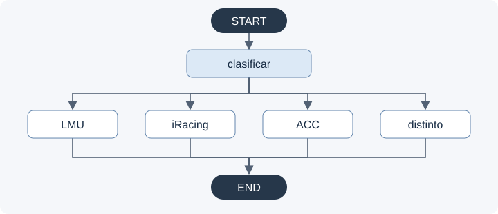

# BOX · Ingeniero de pista para simracing

Proyecto de Carlos Peñalver para el módulo de IA Generativa del máster.

BOX interpreta lo que nota el piloto, pregunta por el contexto y propone una prueba de ajuste apoyada en documentación. Usa **Gemini, ChromaDB y LangGraph sobre LangChain**, con un núcleo compartido entre el notebook obligatorio y la web en Streamlit.

La aplicación funciona localmente y está preparada para Streamlit Community Cloud. Las respuestas tienen una evaluación documental parcial; no son reglajes verificados en pista. Resultados y límites en [EVALUACION.md](docs/EVALUACION.md).

## Funcionamiento



Un clasificador Gemini con salida estructurada validada dirige cada consulta a LMU, iRacing, ACC o la rama de aclaraciones y otros simuladores. Las ramas especializadas recuperan tres fichas del simulador correspondiente y generan la respuesta. La memoria temporal conserva el historial y pide confirmación antes de cambiar coche o simulador. No se comparten conversaciones entre sesiones.

El corpus tiene **75 fichas: 25 LMU, 20 iRacing y 30 ACC**, procedentes de tres fuentes. Cada ficha completa es un fragmento. Se usa Gemini Embedding 2, con 3072 dimensiones y distancia coseno. Fuentes y reproducción en [FUENTES.md](docs/FUENTES.md) e [inventario](docs/corpus_mvp.json).

La web ofrece **3.5 Flash-Lite, 3.1 Flash-Lite, 3 Flash Preview, 3.6 Flash y 3.8 Flash**. El modelo elegido clasifica y responde; cambiarlo conserva conversación y borrador. La disponibilidad y cuota dependen del proyecto de Google. Un turno especializado consume normalmente dos invocaciones al LLM y un embedding de consulta; el SDK permite hasta tres intentos por invocación ante errores transitorios. Se muestran avisos seguros de saturación y cuota agotada.

La web muestra la respuesta sin citas ni enlaces; conserva las evidencias y el modelo usado en memoria de esa sesión. El notebook mantiene citas y cinco ejemplos realmente ejecutados. La fidelidad sigue siendo parcial y cambiar de modelo puede cambiar el consejo.

## Ejecutar en local

Usar **Python 3.12**, desde la raíz del repositorio:

```powershell
python -m venv .venv
.\.venv\Scripts\python.exe -m pip install -r requirements.txt
.\.venv\Scripts\python.exe -m pip check
Copy-Item .env.example .env
.\.venv\Scripts\python.exe -m streamlit run app.py --server.address 127.0.0.1
```

Crear el entorno y copiar `.env.example` solo si todavía no existen. Completar `.env` con `GOOGLE_API_KEY`, `GEMINI_MODEL` y `GEMINI_EMBEDDING_MODEL`. Nunca subir claves al repositorio. El `.env` local tiene prioridad sobre las variables heredadas. Abrir http://127.0.0.1:8501.

El corpus y los vectores **no se publican en GitHub**. Si faltan, la web pide el paquete privado de esta versión. Contiene las fichas preparadas y los vectores ya calculados, sin credenciales ni conversaciones. Se verifica su huella y se reconstruye Chroma sin llamar a Gemini. Solicitar el paquete al autor; no se descargan ni regeneran los datos automáticamente.

«Nueva conversación» borra mensajes, evidencias y checkpoints anteriores. La memoria no es permanente: se pierde al terminar la sesión o reiniciar el servidor.

## Notebook de la entrega

Abrir [notebooks/proyecto.ipynb](notebooks/proyecto.ipynb) con el kernel de `.venv`. Restaurar primero el paquete privado mediante la web local si faltan los datos. Ejecutar configuración, corpus, índice y creación del agente; después, las funciones y el inicio del chat.

El chat interpreta el contexto en lenguaje natural y admite `/nuevo` y `/salir`. Después hay cinco ejemplos con salidas nativas guardadas: LMU, seguimiento, iRacing, ACC y una cifra no disponible. Leerlas no consume API; ejecutarlas otra vez sí. Al ejecutar todo, escribir `/salir` para continuar con los ejemplos.

## Desplegar en Streamlit Community Cloud

Guía y protección de cuota en **[DESPLIEGUE.md](docs/DESPLIEGUE.md)**. Entrada: `app.py`, rama `main`, Python 3.12. Hacer la aplicación **privada antes de añadir la clave**. Plantilla sin secretos en [.streamlit/secrets.example.toml](.streamlit/secrets.example.toml).

El logo completo de `ui/box-logo.png` aparece en la bienvenida con «En boxes y listo para escucharte»; la barra lateral encuadra su texto original. La bienvenida desaparece al empezar a conversar.

## Pruebas y reproducción

```powershell
.\.venv\Scripts\python.exe -m unittest discover -s tests -v
```

Las pruebas usan respuestas controladas y vectores locales, sin consumir Gemini. La apertura de recursos reales se comprueba cuando está disponible el paquete privado; esa prueba se omite en una copia sin datos. Comprueban funcionamiento, no exactitud física.

`scripts/evaluate_routing.py` y `scripts/evaluate_cases.py` ejecutan evaluaciones reales solo con `--run`, reutilizan resultados y documentan errores. `scripts/build_corpus.py` reproduce las fichas desde las copias privadas. No ejecutar evaluaciones ni volver a generar embeddings por rutina.

En una copia que tenga el corpus y el índice se puede preparar el paquete privado:

```powershell
.\.venv\Scripts\python.exe deployment.py --export outputs/box_datos_privados.json.gz
```

Se actualiza `deployment_manifest.json`, que debe acompañar exactamente a ese paquete. Se publica solo el manifiesto con la huella, nunca el paquete.

## Archivos principales

- `agent.py`: clasificación, recuperación, respuesta y memoria.
- `retrieval.py`: embeddings, firma del corpus y Chroma.
- `app.py`, `web_runtime.py` y `ui/`: web y recursos por sesión.
- `deployment.py`, `deployment_manifest.json`: exportación y carga privada sin API.
- `prompts/`: instrucciones del agente, clasificador y control de fuentes.
- `notebooks/`, `tests/`, `scripts/` y `docs/`: entrega, comprobaciones y reproducción.

Quedan fuera de Git los secretos, corpus, índices, resultados privados, entornos, respaldos y notas internas. No se ha realizado comparación sin RAG, descartada por el alumno al no exigirla el enunciado.
